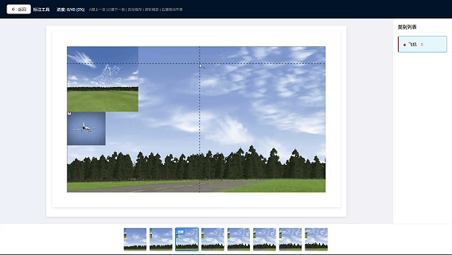
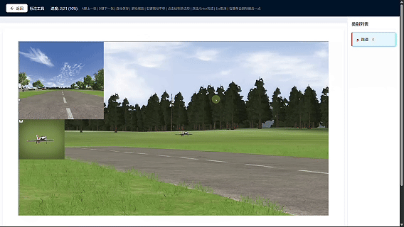

<p align="center">
  <h1 align="center">YOLO-Label</h1>
  <p align="center"><strong>标注 → 训练 → 部署，一个平台全搞定</strong></p>
  <p align="center">开源的一站式 YOLO 标注与训练平台，让计算机视觉项目从数据标注到模型产出的全流程在一个界面内闭环。</p>
</p>

<p align="center">
  <a href="https://www.gnu.org/licenses/agpl-3.0"></a>
  <a href="https://www.python.org/"></a>
  <a href="https://reactjs.org/"></a>
  <a href="https://github.com/ultralytics/ultralytics"></a>
  <a href="https://fastapi.tiangolo.com/"></a>
</p>

---

## 为什么选择 YOLO-Label？

传统工作流需要在标注工具、脚本、训练框架之间反复切换，YOLO-Label 将这一切整合到了一个 Web 平台中：

- **标注即训练** — 标注完成后直接在平台内训练 YOLO11 模型，无需导出到其他工具，告别繁琐的格式转换和环境配置
- **AI 提效** — 集成 YOLO11 预标注，自动生成初版标注，人工只需微调，效率提升数倍
- **开箱即用** — Docker 一键部署，支持 GPU 加速，5 分钟即可开始标注
- **团队协作** — 任务包分配、三级权限管理，适合 1~15 人标注团队并行作业

## 功能一览

| 功能 | 说明 |
|------|------|
| **目标检测标注** | 矩形框标注，快捷键切换类别，支持 YOLO 格式导入导出 |
| **实例分割标注** | 多边形标注，支持顶点增删、右键操作，精细勾勒目标轮廓 |
| **AI 预标注** | 上传已有 YOLO11 模型自动为图片生成标注，大幅减少手工工作量 |
| **一键训练** | 平台内直接训练 YOLO11，实时查看训练进度与指标曲线 |
| **RKNN 转换（RK3588）** | 训练完成后可自动将 `.pt` 转换为瑞芯微 RK3588 用 `.rknn`（INT8 量化），并打包 PT+RKNN 一键下载，直达边缘部署 |
| **项目导出与导入** | 完整项目打包（图片+类别+标注）一键导出，支持跨实例迁移与备份 |
| **权限与协作** | 超级管理员 / 项目管理员 / 标注员三级权限，任务包分配与进度追踪 |
| **Docker 部署** | 完全容器化，支持 GPU / CPU / 离线部署，无环境依赖 |

## 使用演示

### 目标检测标注



### 实例分割标注



---

## 快速开始

### Linux / macOS

```bash
git clone https://gitee.com/junzixing/yolo-label.git
cd yolo-label

# 生产环境部署（交互式引导：Docker/GPU/密码/端口）
./manage.sh prod deploy

# 测试环境部署（默认配置，支持热重载）
./manage.sh test deploy
```

### Windows 11

需要 [Docker Desktop](https://www.docker.com/products/docker-desktop/)（启用 WSL2 后端）。GPU 用户额外需要 NVIDIA 显卡驱动（≥ 535，自带 WSL2 GPU 支持，**无需单独安装 CUDA Toolkit**）。详见 [`docs/WINDOWS.md`](docs/WINDOWS.md)。

```cmd
git clone https://gitee.com/junzixing/yolo-label.git
cd yolo-label

REM 双击 scripts\yolo-label.bat 即可打开控制面板（启动/停止/状态/日志/重建）
scripts\yolo-label.bat
```

### 系统要求

| 项目 | 最低要求 |
|------|---------|
| 操作系统 | Ubuntu 22.04 / 24.04 或支持 Docker 的 Linux ；或 **Windows 11 + Docker Desktop (WSL2)** |
| 内存 | 2 GB（训练建议 8 GB+）|
| 磁盘 | 4 GB（首次构建约 17 GB）|
| GPU（可选）| NVIDIA 显卡。Linux 需安装 [Container Toolkit](https://docs.nvidia.com/datacenter/cloud-native/container-toolkit/install-guide.html)；Windows 仅需新版 NVIDIA 驱动 + Docker Desktop 启用 GPU 支持 |

### 常用命令

| 命令 | 说明 |
|------|------|
| `./manage.sh prod deploy` | 首次生产部署 |
| `./manage.sh prod redeploy` | 重新部署（可选保留数据） |
| `./manage.sh prod restart` | 重启服务 |
| `./manage.sh status` | 查看状态 |
| `./manage.sh logs [服务名]` | 查看日志 |

### 访问地址

| 服务 | 地址 |
|------|------|
| 前端界面 | http://localhost:3000 |
| API 文档 | http://localhost:8000/docs |

- **测试环境**：默认账号 `admin` / `admin123`

---

## 模型训练

YOLO-Label 内置完整的 YOLO11 训练流程，标注完成后无需离开平台即可得到可部署的模型。

### 训练流程

```
选择基础模型 → 配置训练参数 → 后台训练 → 实时监控 → 下载模型
```

1. **前置条件**：项目内至少 10 张已标注图片 + 1 个类别
2. **选择基础模型**：支持 YOLO11 全系列（yolo11n / yolo11s / yolo11m / yolo11l / yolo11x），按精度-速度需求选择
3. **配置参数**：训练轮数、批次大小、图片尺寸等，提供合理默认值
4. **后台执行**：训练在 Celery 后台运行，关闭浏览器也不会中断
5. **实时监控**：训练过程中可查看 loss、mAP 等指标变化
6. **下载结果**：训练完成后可下载：
   - `.pt` 模型文件 — 直接用于推理部署
   - 完整训练包（zip）— 包含数据集、模型权重、训练曲线图，方便复现与分享
   - **PT+RKNN 包（zip）** — 若开启了 RKNN 转换，打包 `.pt` 与 `.rknn` 一并下载（见下）

### 训练模式

| 项目类型 | 训练模式 | 基础模型示例 |
|---------|---------|------------|
| 目标检测 | Detection | yolo11n.pt / yolo11s.pt |
| 实例分割 | Segmentation | yolo11n-seg.pt / yolo11s-seg.pt |

系统根据项目类型自动选择对应的基础模型，无需手动切换。

### 离线训练

Docker 容器可能无法访问外网下载基础模型，可提前在宿主机预下载：

```bash
./scripts/download_yolo_models.sh
```

脚本会把 YOLO11 全系列模型下载到本地 `models/` 目录（该目录已通过 Docker 卷挂载进容器），训练时优先使用本地缓存。

### RKNN 转换（部署到 RK3588）

面向瑞芯微 RK3588 边缘设备，平台可在训练完成后自动把 `.pt` 转换为 INT8 量化的 `.rknn`。

1. **发起训练时**勾选 **「训练完成后转换为 RKNN（RK3588，INT8 量化）」**（默认开启）
2. 训练完成后，转换在后台异步进行；训练历史中会显示 **「RKNN 转换中 → 已转换 RKNN」** 状态
3. 转换完成后点击 **「下载 PT+RKNN 包」** 获取含 `.pt` 与 `.rknn` 的压缩包

说明：

- **量化校准图**自动复用本次训练的验证集（数量不足时从训练集补足），无需额外准备
- 转换由独立的 **`rknn-worker`** 容器处理（内置 RKNN Toolkit2，运行于独立 Python 3.10 环境，与主训练环境隔离），**纯 CPU 即可，无需 GPU**
- 转换链路：`PT → ONNX → RKNN(INT8)`，支持检测与分割模型

---

## AI 预标注

1. 在 **模型管理** 页面上传 YOLO11 模型（`.pt`）
2. 进入项目详情，点击 **AI 预标注**，选择模型和类别映射
3. 任务在后台执行，完成后可查看并修正自动生成的标注

无 GPU 时自动使用 CPU，功能完整，速度较慢。

---

## 项目导出与导入

### 导出

在项目详情页点击 **导出** 下拉菜单：

- **导出 YOLO 格式（仅已标注）**：仅包含已标注的图片和标注文件，适合直接用于训练或下游任务
- **导出完整项目（可导入）**：包含项目元数据、类别、全部图片及标注，可用于迁移或备份

### 导入

在 **项目管理** 页点击 **导入项目**，选择之前导出的 zip 文件即可。导入完成后自动跳转到新项目详情页。导入项目需具备项目管理员或超级管理员权限。

---

## GPU 支持（可选）

安装 [NVIDIA Container Toolkit](https://docs.nvidia.com/datacenter/cloud-native/container-toolkit/install-guide.html) 后，部署时选择启用 GPU，可大幅加速预标注与模型训练。

```bash
# 验证 GPU 是否可用
docker run --rm --gpus all nvidia/cuda:12.1.0-base-ubuntu22.04 nvidia-smi
```

---

## 离线部署

```bash
# 联网环境打包
./manage.sh offline package

# 目标服务器解压后
tar -xzf yolo-label-offline-*.tar.gz
cd yolo-label-offline-*
./deploy.sh
```

---

## 技术栈

| 层级 | 技术 |
|------|------|
| 前端 | React 18 + TypeScript + Ant Design + Fabric.js |
| 后端 | FastAPI + PostgreSQL 15 + Redis |
| AI | YOLO11 (ultralytics) + PyTorch 2.7（cu128，支持 Blackwell GPU）|
| 边缘部署 | RKNN Toolkit2（PT→ONNX→RKNN，RK3588）|
| 任务队列 | Celery + Redis（训练/预标注走默认队列，RKNN 转换走独立 `rknn` 队列）|
| 部署 | Docker + Docker Compose |

---

## 常见问题

| 问题 | 解决方案 |
|------|---------|
| 端口被占用 | 部署时脚本会自动检测并推荐可用端口 |
| GPU 不可用 | 确认 `nvidia-smi` 正常，已安装 NVIDIA Container Toolkit |
| 预标注无结果 | 确认 Celery worker 正常运行：`docker logs yolo-label-celery-worker` |
| 训练卡在下载模型 | 执行 `./scripts/download_yolo_models.sh` 预下载模型到本地 |
| RKNN 一直「转换中」/ 转换失败 | 查看转换 worker 日志：`docker logs yolo-label-rknn-worker` |
| 新 GPU（Blackwell，如 RTX 50 系 / RTX PRO Blackwell）训练报 `no kernel image` | 需 torch ≥2.7+cu128（本项目已默认）；并确认宿主 NVIDIA 驱动 ≥ 570 |

---

## 关注与交流

欢迎关注 **「怒飞垂云」** 公众号，获取最新动态、使用教程和技术分享：


---

## 许可证

本项目采用 [GNU AGPL-3.0](./LICENSE) 许可证。

> 本项目的模型训练与推理基于 [Ultralytics YOLO](https://github.com/ultralytics/ultralytics)（AGPL-3.0 许可）。依据 AGPL-3.0，若将本项目作为网络服务对外提供，需向使用者公开对应的源代码；如需用于闭源商业场景以规避 AGPL 义务，请向 Ultralytics 申请商业授权。

## 致谢

- [YOLO / ultralytics](https://github.com/ultralytics/ultralytics)
- [FastAPI](https://fastapi.tiangolo.com/)
- [React](https://reactjs.org/)
- [Ant Design](https://ant.design/)
